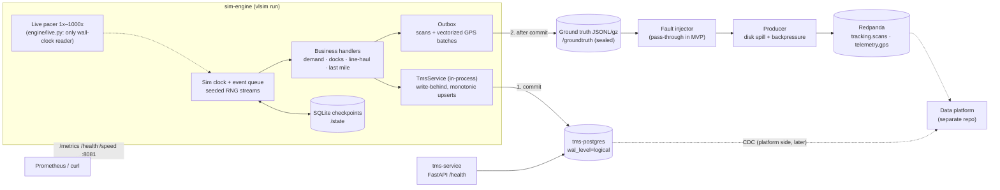

# VietLink Express simulator

A 24/7 discrete-event simulator that plays the source systems of a fictional Vietnamese logistics company for a separate data platform:
- **TMS Postgres** (OLTP rows that are updated in place, ready for CDC);
- **Redpanda** topics `tracking.scans` and `telemetry.gps`;
- a sealed **ground-truth** log of everything that was emitted.

The specification is [docs/SPEC.md](docs/SPEC.md). Design decisions are in [docs/adr/](docs/adr/), modelling assumptions in [docs/ASSUMPTIONS.md](docs/ASSUMPTIONS.md), measurements in [docs/BENCHMARKS.md](docs/BENCHMARKS.md), and the shipment lifecycle in [docs/STATE_MACHINE.md](docs/STATE_MACHINE.md).

## Architecture



Order within every flush (ADR 0009): **Postgres commits first**, then the matching events go to ground truth, then the fault injector, then Redpanda. Topics never run ahead of the database.

## Quick start

```bash
make up                 # Postgres + Redpanda (Compose profile "core"), waits until healthy
make migrate            # TMS schema (Alembic)
make seed               # deterministic master data (PRESET=s|m)
make topics             # tracking.scans + telemetry.gps: 6 partitions, 7-day retention
uv run vlsim simulate --days 7 --run-id demo   # fast batch run (no pacing)
make reconcile RUN=demo                         # ground truth vs topics vs Postgres
```

Live mode, as a container:

```bash
VLSIM_SPEED=60 make up-sim          # tms-service + sim-engine on top of core
curl localhost:8081/health          # {"status": "ok" | "degraded" | "failing", ...}
curl -X POST "localhost:8081/speed?x=500"   # change speed at runtime (1–1000)
docker compose --profile core --profile sim stop sim-engine   # SIGTERM: final checkpoint, exit 0
```

Live mode, from the host:

```bash
uv run vlsim run --speed 1000 --run-id live --state-dir data/state --ground-truth-dir data/groundtruth
```

## Make targets

| Target | What it does |
|---|---|
| `make up` / `make down` | Start or stop the core services (Postgres, Redpanda) |
| `make up-sim` | Core + `tms-service` + `sim-engine` (live, `VLSIM_SPEED`, default 1) |
| `make clean` | Down **and delete volumes** (TMS data, topics, ground truth, checkpoints) |
| `make migrate` / `make migrate-down` | Apply or roll back the TMS schema |
| `make seed PRESET=s` | Idempotent master data |
| `make topics` | Create topics and align their retention |
| `make lint` / `make test` / `make test-integration` | ruff + mypy / unit tests / tests against Postgres + Redpanda (needs `make up`) |
| `make reconcile RUN=<id>` | Compare a run's ground truth with Redpanda and Postgres; exits 1 on a mismatch |
| `make soak [SOAK_HOURS=24] [SOAK_SPEED=60]` | Live soak with a scripted kill -9 and a Redpanda pause; CSV samples; then reconcile |

## Soak test (24 h)

`make soak` runs scale S live for `SOAK_HOURS` (default 24) at `SOAK_SPEED` (default 60x, so about 60 sim days; use 1 for real time). At random times it kills the simulator with `kill -9` and restarts it, and pauses Redpanda for `PAUSE_SECONDS` (120). Every `SAMPLE_SECONDS` (300) it samples RSS, disk (state, ground truth, Redpanda, Postgres), spill backlog, pacing drift and health into `data/soak/<run>/samples.csv`. At the end it stops the simulator with SIGTERM (it must exit 0) and runs reconcile. The result is in `data/soak/<run>/result.txt`.

```bash
caffeinate -dimsu &        # macOS: keep the machine awake for the whole run
make up
make soak                  # 24 h at 60x; or: make soak SOAK_HOURS=24 SOAK_SPEED=1
cat data/soak/*/result.txt
```

It uses its own database (`vlsim_soak`), its own run id and port 18081, so it does not touch `tms` or the Compose sim-engine. A short rehearsal: `make soak SOAK_HOURS=0.1`.

## Ports

| Port (host) | Service | Notes |
|---|---|---|
| 55432 | tms-postgres | `TMS_PG_PORT`. Not 5432, because a native Postgres on the dev Mac holds it (ADR 0004) |
| 19092 | Redpanda Kafka API | `REDPANDA_PORT`. Inside the network: `redpanda:9092` |
| 8000 | tms-service | `GET /health` |
| 8081 | sim-engine | `GET /metrics` (Prometheus), `GET /health`, `GET\|POST /speed?x=N` |

## Volumes

| Volume | Mounted in | Contents |
|---|---|---|
| `tms-pgdata` | tms-postgres | TMS database (logical WAL for CDC, ADR 0006) |
| `redpanda-data` | redpanda | Topic data (7-day / size-capped retention, ADR 0010) |
| `groundtruth` | **sim-engine only** | `<run_id>/<topic>/<sim-date>.jsonl[.gz]`: the answer key; the platform must never read it |
| `sim-state` | sim-engine | `checkpoints.sqlite` and the producer's `spill.jsonl` |

## Determinism

- The same seed and config give byte-identical output **on the same OS and architecture**. CI checks golden hashes per OS-arch (`tests/golden/repro_hashes.json`).
- **Hashes may differ between arm64 and amd64**, or between macOS and Linux. Transcendental maths (numpy and libm `sin`, `cos`, `exp`, `log`) may round differently per platform and SIMD path, and a last-bit difference can shift a rounded coordinate or a millisecond.
- On 2026-10-17 all three platforms we checked agreed (Darwin-arm64, Linux-aarch64, Linux-x86_64), but that is not guaranteed (ADR 0012).

## Troubleshooting

| Symptom | Fix |
|---|---|
| `docker: command not found` (macOS) | Add `~/.docker/bin` to PATH (Docker Desktop does this in `~/.zprofile`; open a new login shell) |
| Tests or CLI connect to the wrong Postgres | A native Postgres holds 5432. The TMS runs on **55432**; check `TMS_PG_PORT` / `VLSIM_TMS_DSN` |
| `sqlite3.OperationalError: unable to open database file` in sim-engine | The `sim-state` / `groundtruth` volumes were created by an older image as root. If empty, `docker volume rm vlsim_sim-state vlsim_groundtruth`, then `make up-sim` |
| `/health` says `degraded` | Redpanda is unreachable or the producer is spilling to disk. The simulation continues; the backlog drains when Redpanda is back (`vlsim_spill_backlog_bytes`) |
| `/health` says `failing` (503) | Postgres is unreachable. The simulator retries with backoff and emits nothing until commits succeed |
| `config fingerprint differs from the checkpoint's` | Config changed under an existing run. Use a new `--state-dir`/`--run-id`, or `make clean` |
| `run X already holds a run` | Fresh start into a used ground-truth dir. Pick a new `--run-id` or resume with the same `--state-dir` |
| Reconcile reports missing events mid-run | Expected: topics trail Postgres by up to one flush. Reconcile after a clean stop (SIGTERM) |
| Ground truth disappeared on resume | By design: everything after the last checkpoint is truncated and rewritten identically by replay (ADR 0011) |
| Seed data changed after a config change (e.g. fleet mix) | `make clean && make up && make migrate && make seed` |
