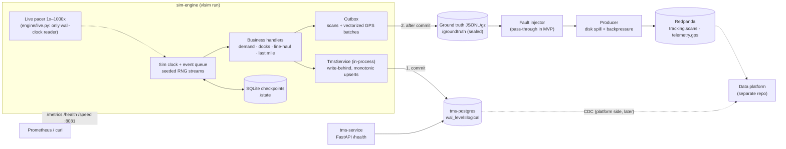

# VietLink Express simulator

A 24/7 discrete-event simulator that plays the source systems of a fictional Vietnamese logistics company for a separate data platform:
- **TMS Postgres** (OLTP rows that are updated in place, ready for CDC);
- **Redpanda** topics `tracking.scans` and `telemetry.gps`;
- a sealed **ground-truth** log of everything that was emitted.

The specification is [docs/SPEC.md](docs/SPEC.md). Design decisions are in [docs/adr/](docs/adr/), modelling assumptions in [docs/ASSUMPTIONS.md](docs/ASSUMPTIONS.md), measurements in [docs/BENCHMARKS.md](docs/BENCHMARKS.md), and the shipment lifecycle in [docs/STATE_MACHINE.md](docs/STATE_MACHINE.md).

## Architecture



Order within every flush (ADR 0009): **Postgres commits first**, then the matching events go to ground truth, then the fault injector, then Redpanda. Topics never run ahead of the database.

## Quick start

```bash
make up                 # Postgres + Redpanda (Compose profile "core"), waits until healthy
make migrate            # TMS schema (Alembic)
make seed               # deterministic master data (PRESET=s|m)
make topics             # tracking.scans + telemetry.gps: 6 partitions, 7-day retention
uv run vlsim simulate --days 7 --run-id demo   # fast batch run (no pacing)
make reconcile RUN=demo                         # ground truth vs topics vs Postgres
```

Live mode, as a container:

```bash
VLSIM_SPEED=60 make up-sim          # tms-service + sim-engine on top of core
curl localhost:8081/health          # {"status": "ok" | "degraded" | "failing", ...}
curl -X POST "localhost:8081/speed?x=500"   # change speed at runtime (1–1000)
docker compose --profile core --profile sim stop sim-engine   # SIGTERM: final checkpoint, exit 0
```

Live mode, from the host:

```bash
uv run vlsim run --speed 1000 --run-id live --state-dir data/state --ground-truth-dir data/groundtruth
```

## Make targets

| Target | What it does |
|---|---|
| `make up` / `make down` | Start or stop the core services (Postgres, Redpanda) |
| `make up-sim` | Core + `tms-service` + `sim-engine` (live, `VLSIM_SPEED`, default 1) |
| `make clean` | Down **and delete volumes** (TMS data, topics, ground truth, checkpoints) |
| `make migrate` / `make migrate-down` | Apply or roll back the TMS schema |
| `make seed PRESET=s` | Idempotent master data |
| `make topics` | Create topics and align their retention |
| `make lint` / `make test` / `make test-integration` | ruff + mypy / unit tests / tests against Postgres + Redpanda (needs `make up`) |
| `make reconcile RUN=<id>` | Compare a run's ground truth with Redpanda and Postgres; exits 1 on a mismatch |
| `make soak [SOAK_HOURS=24] [SOAK_SPEED=60] [SOAK_MODE=host\|container]` | Live soak with a scripted crash and a Redpanda pause; CSV samples; then reconcile |
| `make clean-scratch` | Drop scratch databases (`vlsim_*`); never touches `tms` |

## Soak test (24 h)

`make soak` runs scale S live for `SOAK_HOURS` (default 24) at `SOAK_SPEED` (default 60x, so about 60 sim days; use 1 for real time). At random times it kills the simulator with `kill -9` and restarts it, and pauses Redpanda for `PAUSE_SECONDS` (120). Every `SAMPLE_SECONDS` (300) it samples RSS, disk (state, ground truth, Redpanda, Postgres), spill backlog, pacing drift and health into `data/soak/<run>/samples.csv`. At the end it stops the simulator with SIGTERM (it must exit 0) and runs reconcile. The result is in `data/soak/<run>/result.txt`.

```bash
caffeinate -dimsu &        # macOS: keep the machine awake for the whole run
make up
make soak                  # 24 h at 60x; or: make soak SOAK_HOURS=24 SOAK_SPEED=1
cat data/soak/*/result.txt
```

It uses its own database (`vlsim_soak`), its own run id and port 18081, so it does not touch `tms` or the Compose sim-engine. A short rehearsal: `make soak SOAK_HOURS=0.1`.

## Deploy (x86 Ubuntu Server 24.04, 16 GB)

The server runs the same images as dev with three Compose files:

| File | Role |
|---|---|
| `compose.yaml` | Base: restart policies, memory limits, log rotation (5 × 20 MB per container), ports bound to `${BIND_ADDR:-127.0.0.1}` |
| `compose.server.yaml` | Redpanda without dev mode (fsync on, write caching off, 7-day retention, 5 GiB min free), required secrets, image tag |
| `compose.server-data.yaml` | The four volumes bound to directories under `DATA_ROOT` on the big disk |

All settings live in `.env` (from `deploy/server.env.example`, `chmod 600`, never committed).

Memory limits (no swap):

| Container | Limit |
|---|---|
| tms-postgres | 2 GiB |
| redpanda | 1.5 GiB (Seastar `--memory=1G`) |
| tms-service | 256 MiB |
| sim-engine | **480 MiB** (measured peak RSS: 130 MB at S, 180 MB at M) |

Total: about 4.2 GiB of 16 GiB. Topic partitions, retention and size caps (ADR 0010) are applied by sim-engine on every start.

### First-time setup

```bash
sudo apt-get update && sudo apt-get install -y ca-certificates curl git make openssl
```
```bash
sudo install -m 0755 -d /etc/apt/keyrings && sudo curl -fsSL https://download.docker.com/linux/ubuntu/gpg -o /etc/apt/keyrings/docker.asc
```
```bash
echo "deb [arch=$(dpkg --print-architecture) signed-by=/etc/apt/keyrings/docker.asc] https://download.docker.com/linux/ubuntu $(. /etc/os-release && echo "$VERSION_CODENAME") stable" | sudo tee /etc/apt/sources.list.d/docker.list
```
```bash
sudo apt-get update && sudo apt-get install -y docker-ce docker-ce-cli containerd.io docker-buildx-plugin docker-compose-plugin
```
```bash
sudo usermod -aG docker "$USER"   # then log out and back in
```
```bash
curl -LsSf https://astral.sh/uv/0.12.13/install.sh | sh   # host-side tools: reconcile, tests, host-mode soak
```

Create the data directories on the 2 TB disk. `/srv/vlsim` must be on that disk: mount it there, or set `DATA_ROOT` to wherever it is mounted.

```bash
sudo mkdir -p /srv/vlsim/postgres /srv/vlsim/redpanda /srv/vlsim/groundtruth /srv/vlsim/state
```
```bash
sudo chown 101:101 /srv/vlsim/redpanda && sudo chown 10001:10001 /srv/vlsim/groundtruth /srv/vlsim/state && sudo chmod 700 /srv/vlsim/groundtruth
```

`postgres/` is chowned to UID 999 by the Postgres image on its first start. UID 101 is Redpanda's user and 10001 is the `vlsim` user in our image.

Clone, configure and start:

```bash
git clone https://github.com/fvncent/logistics-sim.git ~/logistics-sim && cd ~/logistics-sim
```
```bash
cp deploy/server.env.example .env && chmod 600 .env
```
```bash
PW=$(openssl rand -hex 24) && sed -i "s/^TMS_PG_PASSWORD=.*/TMS_PG_PASSWORD=$PW/; s#vlsim:CHANGE_ME@#vlsim:$PW@#; s/^VLSIM_IMAGE_TAG=.*/VLSIM_IMAGE_TAG=$(git rev-parse --short HEAD)/" .env && unset PW
```
```bash
docker compose config -q && docker compose build && docker compose up -d --wait
```
```bash
docker compose ps && curl -s localhost:8081/health && curl -s localhost:8081/metrics | grep -E '^vlsim_(sim_time|speed|spill)'
```

`tms-service` applies the migrations, `sim-engine` seeds master data (idempotent) and creates the topics. Live mode then runs at `VLSIM_SPEED` (`.env`; default 1x, M preset). `docker compose stop sim-engine` stops it gracefully (final checkpoint, exit 0). `restart: unless-stopped` brings everything back after a crash or a reboot. Check the reproducibility golden once on the server: `uv run pytest tests/unit/test_reproducibility.py` (see "Differences from the dev Mac").

Reaching it from your laptop:
- **Recommended:** keep `BIND_ADDR=127.0.0.1` and use `ssh -L 8081:127.0.0.1:8081 server`, or `tailscale serve --bg --tcp 8081 tcp://127.0.0.1:8081`.
- **Binding the Tailscale interface directly:** set `BIND_ADDR` to the server's `100.x.y.z`. The interface must exist before Docker starts containers at boot. Add `printf '[Unit]\nAfter=tailscaled.service\nWants=tailscaled.service\n' | sudo tee /etc/systemd/system/docker.service.d/10-after-tailscale.conf && sudo systemctl daemon-reload`. This is **untested here**.
- For Kafka clients on other machines, set `REDPANDA_ADVERTISE_HOST` to a name they can reach.
- Never use `0.0.0.0`: Docker-published ports bypass `ufw`.

### Upgrade

```bash
cd ~/logistics-sim && git fetch --tags && OLD=$(git rev-parse --short HEAD)
```
```bash
docker compose stop sim-engine   # graceful: final checkpoint
```
```bash
mkdir -p ~/backups && docker compose exec -T tms-postgres pg_dump -U vlsim -Fc tms > ~/backups/tms-$OLD.dump && sudo tar -C /srv/vlsim -czf ~/backups/state-$OLD.tgz state
```
```bash
git checkout <new-tag-or-commit> && git diff --stat "$OLD"..HEAD -- config ':!config/transport.yaml' migrations
```
```bash
sed -i "s/^VLSIM_IMAGE_TAG=.*/VLSIM_IMAGE_TAG=$(git rev-parse --short HEAD)/" .env && docker compose build && docker compose up -d --wait
```

- **If the diff lists nothing:** the new image resumes the same run from its checkpoint.
- **If `config/` changed (other than `transport.yaml`):** the config fingerprint changed and sim-engine will refuse the old checkpoint (`config fingerprint differs`, crash loop). Treat it as a **new run**:
  1. `docker compose stop sim-engine`
  2. Archive and empty `/srv/vlsim/state` and `/srv/vlsim/groundtruth/<old run id>`.
  3. Recreate the `tms` database: `docker compose exec -T tms-postgres psql -U vlsim -d postgres -c 'DROP DATABASE tms WITH (FORCE)' -c 'CREATE DATABASE tms'`, then `docker compose restart tms-service`.
  4. Set a new `VLSIM_RUN_ID` in `.env`.
  5. `docker compose up -d --wait`
- **If `migrations/` changed:** `tms-service` applies them on start.

### Rollback

```bash
docker compose stop sim-engine
```
```bash
docker compose exec tms-service alembic downgrade <previous-revision>   # only if the upgrade added a migration
```
```bash
git checkout "$OLD" && sed -i "s/^VLSIM_IMAGE_TAG=.*/VLSIM_IMAGE_TAG=$OLD/" .env && docker compose up -d --wait
```

The old image is still present locally, so no rebuild is needed. If the upgrade started a new run (config change), the checkpoints were written by the newer config. In that case restore the backups instead:
1. `sudo tar -C /srv/vlsim -xzf ~/backups/state-$OLD.tgz`
2. `docker compose exec -T tms-postgres pg_restore -U vlsim -d tms --clean < ~/backups/tms-$OLD.dump` (pg_restore reads the dump from stdin)
3. Set `VLSIM_RUN_ID` back.

### Soaks on the server

Run them inside `tmux` so an SSH disconnect does not end them. `SOAK_MODE=container` runs the **real server stack** (compose.yaml + compose.server.yaml) as an isolated project `vlsimsoak`. It uses its own named volumes and ports (55532, 19192, 8100, 8181), so it does not touch the deployed stack, though both share the machine's RAM and CPU. The crash is a host-side SIGKILL, so the container's restart policy must bring it back. The run also fails if sim-engine was OOM-killed (480 MiB limit) or restarted more than once. The two soaks share the project name, so run them one after the other.

```bash
tmux new -s soak
```
```bash
cd ~/logistics-sim && make soak SOAK_MODE=container SOAK_HOURS=24 SOAK_SPEED=60 PRESET=s
```
```bash
cd ~/logistics-sim && make soak SOAK_MODE=container SOAK_HOURS=24 SOAK_SPEED=1 PRESET=s
```

The first is 24 h accelerated (about 60 sim days, including the run-up to 11.11). The second is a real-time soak (24 h = 1 sim day). Add `PRESET=m` to soak the default server preset.

Reading the results (`data/soak/<run>/`):

```bash
cat data/soak/*/result.txt && cat data/soak/*/events.log
```
```bash
column -s, -t < "$(ls -d data/soak/*/ | tail -1)samples.csv" | less -S
```
```bash
awk -F, 'NR>1 && $5!="" {if($5>m)m=$5} END{print "max RSS kB", m}' "$(ls -d data/soak/*/ | tail -1)samples.csv"
```
```bash
python3 -c "import json,sys; r=json.load(open(sys.argv[1])); print('ok', r['ok']); [print(t, {k: v[k] for k in ('ground_truth_events','topic_distinct','duplicates_in_topic','missing_from_topic')}) for t, v in r['topics'].items()]; print('postgres', r['postgres']['status_mismatches'], 'mismatches')" "$(ls -d data/soak/*/ | tail -1)reconcile.json"
```

`samples.csv` columns (one row every 5 min, plus rows at each event):

| Column | Meaning |
|---|---|
| `wall_utc`, `elapsed_s` | When the sample was taken |
| `event` | periodic / crash_before / after_restart / redpanda_paused / redpanda_unpausing / before_sigterm |
| `pid` | Simulator PID (changes after the crash) |
| `rss_kb` | Simulator memory. It should plateau; a steady climb over hours is a leak |
| `state_kb` | Checkpoints and spill |
| `groundtruth_kb` | Grows about 7.5 MB per sim day at S (gzipped) |
| `redpanda_kb` | Levels off once the 7-day retention or the size caps kick in |
| `postgres_bytes` | TMS database size |
| `spill_backlog_bytes` | > 0 only during and just after the Redpanda pause, then back to 0 |
| `sim_time_s`, `pacing_drift_s` | Sim clock and pacing drift. Drift spikes during the pause (checkpoints wait for acks) and should return to about 0 |
| `health` | ok / degraded (during the pause) / failing |
| `restart_count` | Container mode only; 1 after the crash |

`reconcile.json`:
- `ok` must be `true`.
- Per topic, `missing_from_topic` and `unexpected_in_topic` must be 0. `duplicates_in_topic` > 0 is expected after the crash.
- `postgres.status_mismatches` must be 0.

### Differences from the dev Mac (Apple Silicon)

| Area | Dev Mac | Server | What to do |
|---|---|---|---|
| CPU / reproducibility | Darwin-arm64 golden | Linux-x86_64 golden (recorded under QEMU; real x86 GitHub runners matched on the M6 PR) | Run the reproducibility test once on the Ryzen. A mismatch fails loudly; record it deliberately with `--write-golden` only if you accept that platform's output |
| Redpanda durability | `--mode dev-container`: no fsync, write caching | developer_mode off, write caching off, fsync | The server is slower per write but durable; the benchmarks were measured on the Mac with dev-mode Redpanda |
| Bind-mount ownership | Docker Desktop hides UIDs (and Postgres bind mounts fail there) | Real UIDs | `chown` 101 / 10001 as above (verified only for named volumes here) |
| Memory limits | Inside Docker Desktop's VM | Native cgroups, no swap (`memswap_limit`) | An OOM kill restarts sim-engine and it resumes; the soak fails if it happens |
| Docker CLI | `~/.docker/bin`, Makefile fallback | `/usr/bin/docker` | none |
| Port 5432 | Taken by Homebrew Postgres | Free | Still 55432 for consistency |
| Keep awake | `caffeinate` | none | Use `tmux` |
| Throughput numbers | Measured on the M-series laptop | Not measured on the Ryzen 5 5600 | Re-run `vlsim simulate --days 7` on the server before relying on headroom figures |
| Tailscale | n/a | Not tested | See the caveat above |

## Ports

All ports are published on `${BIND_ADDR:-127.0.0.1}` only.

| Port (host) | Service | Notes |
|---|---|---|
| 55432 | tms-postgres | `TMS_PG_PORT`. Not 5432, because a native Postgres on the dev Mac holds it (ADR 0004) |
| 19092 | Redpanda Kafka API | `REDPANDA_PORT`. Inside the network: `redpanda:9092` |
| 8000 | tms-service | `GET /health` |
| 8081 | sim-engine | `GET /metrics` (Prometheus), `GET /health`, `GET\|POST /speed?x=N` |

## Volumes

| Volume | Mounted in | Contents |
|---|---|---|
| `tms-pgdata` | tms-postgres | TMS database (logical WAL for CDC, ADR 0006) |
| `redpanda-data` | redpanda | Topic data (7-day / size-capped retention, ADR 0010) |
| `groundtruth` | **sim-engine only** | `<run_id>/<topic>/<sim-date>.jsonl[.gz]`: the answer key; the platform must never read it |
| `sim-state` | sim-engine | `checkpoints.sqlite` and the producer's `spill.jsonl` |

## Determinism

- The same seed and config give byte-identical output **on the same OS and architecture**. CI checks golden hashes per OS-arch (`tests/golden/repro_hashes.json`).
- **Hashes may differ between arm64 and amd64**, or between macOS and Linux. Transcendental maths (numpy and libm `sin`, `cos`, `exp`, `log`) may round differently per platform and SIMD path, and a last-bit difference can shift a rounded coordinate or a millisecond.
- On 2026-10-17 all three platforms we checked agreed (Darwin-arm64, Linux-aarch64, Linux-x86_64), but that is not guaranteed (ADR 0012).

## Troubleshooting

| Symptom | Fix |
|---|---|
| `docker: command not found` (macOS) | Add `~/.docker/bin` to PATH (Docker Desktop does this in `~/.zprofile`; open a new login shell) |
| Tests or CLI connect to the wrong Postgres | A native Postgres holds 5432. The TMS runs on **55432**; check `TMS_PG_PORT` / `VLSIM_TMS_DSN` |
| `sqlite3.OperationalError: unable to open database file` in sim-engine | The `sim-state` / `groundtruth` volumes were created by an older image as root. If empty, `docker volume rm vlsim_sim-state vlsim_groundtruth`, then `make up-sim` |
| `/health` says `degraded` | Redpanda is unreachable or the producer is spilling to disk. The simulation continues; the backlog drains when Redpanda is back (`vlsim_spill_backlog_bytes`) |
| `/health` says `failing` (503) | Postgres is unreachable. The simulator retries with backoff and emits nothing until commits succeed |
| `config fingerprint differs from the checkpoint's` | Config changed under an existing run. Use a new `--state-dir`/`--run-id`, or `make clean` |
| `run X already holds a run` | Fresh start into a used ground-truth dir. Pick a new `--run-id` or resume with the same `--state-dir` |
| Reconcile reports missing events mid-run | Expected: topics trail Postgres by up to one flush. Reconcile after a clean stop (SIGTERM) |
| Ground truth disappeared on resume | By design: everything after the last checkpoint is truncated and rewritten identically by replay (ADR 0011) |
| Seed data changed after a config change (e.g. fleet mix) | `make clean && make up && make migrate && make seed` |
