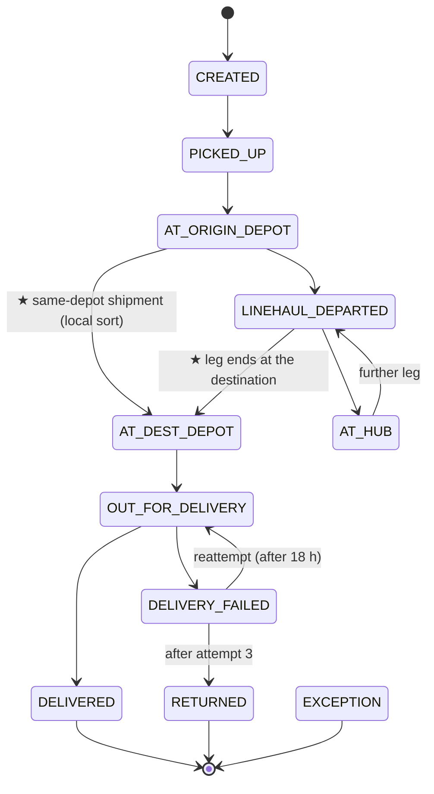

# Shipment state machine

The source of truth in code is `vlsim.models.statemachine.TRANSITIONS`, and `tests/unit/models/test_statemachine.py` keeps this page in sync with it. The states were confirmed on 2026-10-16. EXCEPTION is terminal in the MVP (ADR 0005). Two transitions were added in M4 and accepted on 2026-10-17 (ASSUMPTIONS A40); they are marked ★.

| From | To | When |
|---|---|---|
| (new) | CREATED | order placed |
| CREATED | PICKED_UP | pickup run (10:00 / 16:00) |
| PICKED_UP | AT_ORIGIN_DEPOT | batch unloaded at the origin dock |
| AT_ORIGIN_DEPOT | LINEHAUL_DEPARTED | loaded onto a line-haul departure |
| AT_ORIGIN_DEPOT | AT_DEST_DEPOT ★ | origin = destination: sorted locally, 30 min after unloading |
| LINEHAUL_DEPARTED | AT_HUB | unloaded at an intermediate hub |
| LINEHAUL_DEPARTED | AT_DEST_DEPOT ★ | unloaded at the destination depot (no separate AT_HUB step) |
| AT_HUB | LINEHAUL_DEPARTED | loaded onto the next leg |
| AT_DEST_DEPOT | OUT_FOR_DELIVERY | loaded onto a rider loop |
| OUT_FOR_DELIVERY | DELIVERED | delivered (COD collected if due) |
| OUT_FOR_DELIVERY | DELIVERY_FAILED | attempt failed (`reason_code` on the scan, M5) |
| DELIVERY_FAILED | OUT_FOR_DELIVERY | reattempt, at most 3 attempts in total |
| DELIVERY_FAILED | RETURNED | the 3rd failure, recorded when the rider is back at the depot |
| any non-terminal | EXCEPTION | `damage` (at unload), `lost` (on a line-haul leg), `address_unresolvable` (at a bad address) |

Rules enforced in code and tests:
- Terminal states (DELIVERED, RETURNED, EXCEPTION) have no outgoing transitions.
- A shipment never gets two transitions in the same sim millisecond (ADR 0008).
- `attempt_count` never decreases. RETURNED always has `attempt_count = 3`.
